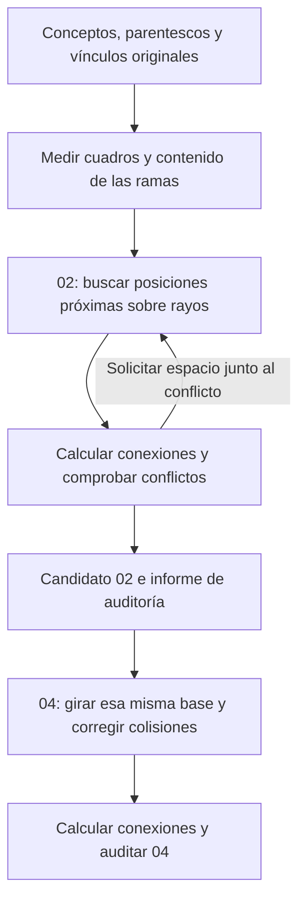

# Motor compacto 0.2.2

Responde a las capturas donde 02 seguía rectangular y 04 ampliaba
excesivamente el diagrama. Cambia distribución y trazado; conserva conceptos,
parentescos, vínculos, normas y la referencia de 01.

## Explicación del cambio

El problema tenía dos partes. Cuando 02 no satisfacía las restricciones del
intento anterior, la interfaz volvía a mostrar 01: se veía el dibujo
rectangular aunque estuviera seleccionada la pestaña radial. En 04, la
reserva de espacio por generaciones producía radios grandes y recorridos
largos. Corregir únicamente el aspecto de las líneas no resolvía esas causas.

Ahora el proceso sigue esta secuencia:

**1. Ubicar los cuadros por el espacio que realmente ocupan.** Se conserva
el núcleo en el centro y se organiza cada rama considerando todo el
contenido que desarrolla. Desde cada padre se prueban direcciones y se
busca el primer hueco donde cabe el hijo con su margen. Dos conceptos de
la misma generación pueden quedar a radios diferentes. La búsqueda compara
candidatos para reducir la separación entre cuadros vinculados; es una
aproximación finita, no una demostración del mínimo global posible.

**2. Reservar espacio para las conexiones.** Un cuadro con muchas conexiones
necesita más salidas que uno terminal. Si el trazador encuentra un corredor
congestionado, solicita espacio junto a ese conflicto y se vuelve a probar
la distribución. Las peticiones de espacio son locales; cada reintento
puede recalcular la distribución completa y cambiar otras posiciones.

Por ejemplo, un hijo que necesita un corredor adicional no impone por sí
solo un nuevo radio a toda su generación. Esa es la diferencia que permite
aprovechar los huecos que señalabas en las capturas.

**3. Transformar 02 para obtener 04.** Se parte de las coordenadas compactas
de 02 y se aplica un giro que aumenta con la distancia al núcleo. Después
se corrigen colisiones cercanas. No equivale a rotar rígidamente todo el
diagrama: los extremos de los brazos giran más y algunos cuadros se
desplazan para seguir teniendo espacio. Los textos conservan su orientación.

**4. Comprobar el resultado por separado.** El motor que propone caminos
no puede aprobarse a sí mismo. Otro componente comprueba que las líneas
lleguen a sus cuadros, respeten obstáculos y no compartan puertos o tramos
prohibidos. También compara el resultado con la referencia 01. Tener las
217 conexiones dibujadas es distinto de conservar sus cruces originales;
esa segunda comprobación todavía falla y permanece visible.

El trabajo pesado se ejecuta en un Worker para mantener disponible la
interfaz. Las vistas calculadas quedan en caché durante la sesión: cambiar
de profundidad o volver a una vista no obliga a calcularla otra vez.

## Dónde está cada responsabilidad

| Componente | Responsabilidad |
| --- | --- |
| [RayPackingLayout.js](../js/geometry/RayPackingLayout.js) | Buscar y comparar posiciones compactas de 02. |
| [SpiralLayout.js](../js/geometry/SpiralLayout.js) | Girar la base 02 y resolver colisiones de 04. |
| [DerivedScene.js](../js/geometry/DerivedScene.js) | Coordinar distribución, trazado y solicitudes de espacio. |
| [OrderedPorts.js](../js/geometry/OrderedPorts.js) | Conservar el orden circular de las conexiones alrededor de cada cuadro. |
| [AvoidRouter.js](../js/geometry/AvoidRouter.js) | Calcular recorridos ortogonales con libavoid/WASM y buscar alternativas a conflictos. |
| [GeometryValidator.js](../js/geometry/GeometryValidator.js) | Auditar la geometría sin confiar en la aprobación del trazador. |
| [DerivedViews.js](../js/views/DerivedViews.js) | Mostrar candidatos, advertencias y cachés de 02/04. |
| [build-site.mjs](../scripts/build-site.mjs) | Publicar todos los módulos bajo una misma identidad de versión. |

## Detalles de implementación

02 busca el primer espacio libre desde cada padre, intersectando rayos con
los rectángulos reales. Considera el contenido de los subárboles y prueba
orientaciones y contactos con obstáculos. La puntuación reduce separación
entre cuadros vinculados. Las generaciones no reciben un radio común ni
se copian las coordenadas rectangulares de 01.

El grado de cada cuadro estima su espacio de salida. El trazador solicita
espacio adicional junto a corredores congestionados. No se amplía todo el
dibujo para resolver un conflicto local. La búsqueda tiene doce pasos como
máximo y conserva el candidato con más rutas seguras, desempantando por
menor separación.

04 parte de la misma 02: aplica giro continuo según radio y corrige
colisiones localmente, conservando avance padre–hijo y textos horizontales.
Si se abre 04 primero, calcula y guarda su base 02. Volver a ella no
reconstruye otro mapa.

libavoid-js/WASM calcula rutas ortogonales en un Worker. La asignación de
puertos conserva el ciclo horario de 01, permitiendo cambiar de cara.
Los conflictos residuales se buscan contra las conexiones ya aceptadas.
Un auditor independiente comprueba extremos, obstáculos, puertos repetidos,
separaciones y cruces antes de dibujar. El simplificador conserva giros
cortos: eliminarlos por medir menos de 0,05 px inventaba diagonales.

`npm run build` produce `_site/` con un hash común en imports, Workers,
CSS y WASM. La versión visible es 0.2.2. Evita el HTML nuevo con módulos
antiguos observado en las capturas. CI prueba el mismo sitio que publica.

Parámetros técnicos, no normas nuevas: espacio inicial `max(24,12+8*grado)`;
separación de rutas y distancia del cruce al giro de 3 px en las derivadas
(trazo máximo 2,8 px); obstáculos a 9 px; salidas de puerto hasta 19 px.
Los saltos se ajustan al espacio local considerando trazo y máscara.
01 conserva su perfil anterior de 6/9 px. Giro de 04: W=0,23 y T=0.

## Evidencia y límites

La prueba Node con métricas congeladas del PPR obtiene 210 cuadros y 217
rutas completas en ambas vistas: cero solapes, rutas inválidas, puertos
repetidos y cambios del orden circular de puertos. Medias entre bordes
vinculados: 272 px en 02 y 452 px en 04, frente a unos 680 px en la
referencia rectangular de esa prueba.

Chrome, con métricas reales de texto, obtiene también 210 cuadros y 217
rutas completas, con medias de 305 y 455 px; cuatro y diez pasos de
capacidad, respectivamente. Zoom, filtros y retorno entre vistas conservan
los cálculos. Estos resultados no garantizan convergencia para otros grafos.

**La compactación visible no acredita aceptación normativa completa.**
Chrome registra 490 diferencias contra la referencia en 02 y 578 en 04,
debidas a pares y secuencias de cruces. Conservar vínculos y ciclos de
puertos no demuestra conservar los cruces de 01. También se incumple la
cota histórica ensayada de 106 px (2H con H=53); no se elevó para aprobar.
D1–D4 siguen abiertos. Las vistas aparecen **EN REVISIÓN**, sin sustituir
la referencia ni exportarse como puntos de control aprobados. Las imágenes
exportadas incluyen ese estado. 01 conserva 217 rutas y 71 cruces.

## Reproducción

`npm ci`, `npm test`, `npm run build`; servir `_site/` por HTTP.
Las tres suites Python aceptan `P1_SITE_ROOT=_site` y `P1_BROWSER_PATH`
para Chrome. `views_e2e.py` admite `P1_SCREENSHOTS`. La prueba del motor
compara con la referencia congelada de 01 y audita toda la geometría.

Dependencia: [THIRD_PARTY.md](../THIRD_PARTY.md).
Fuentes primarias: [libavoid-js](https://github.com/Aksem/libavoid-js),
[pines](https://www.adaptagrams.org/documentation/classAvoid_1_1ShapeConnectionPin.html),
[parámetros](https://www.adaptagrams.org/documentation/namespaceAvoid.html).
